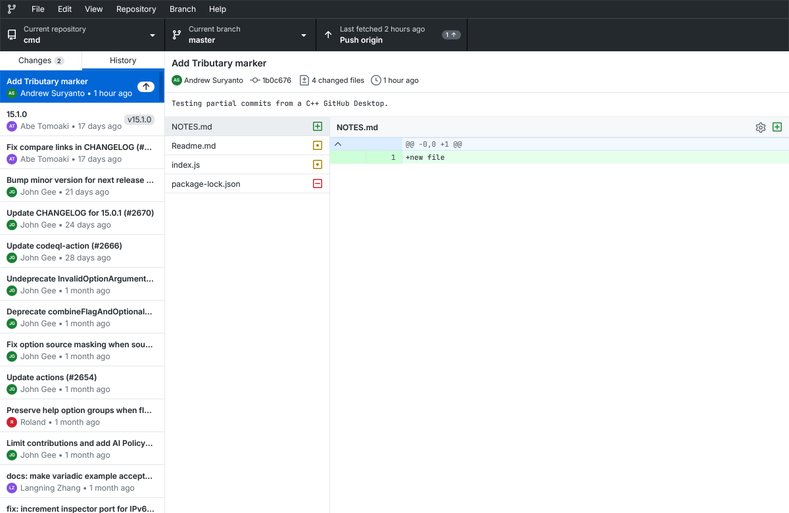
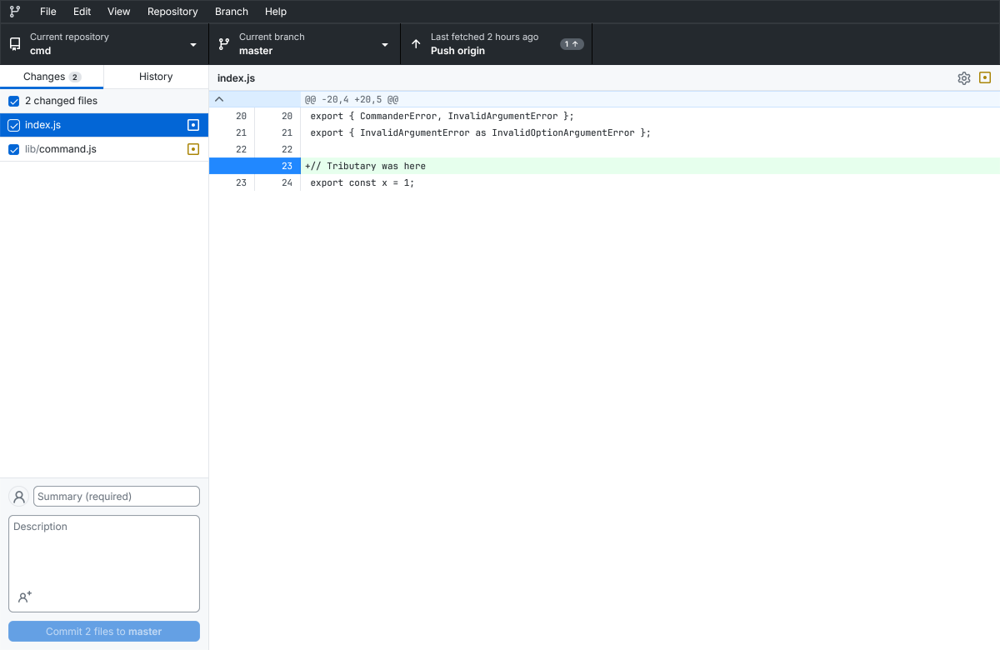
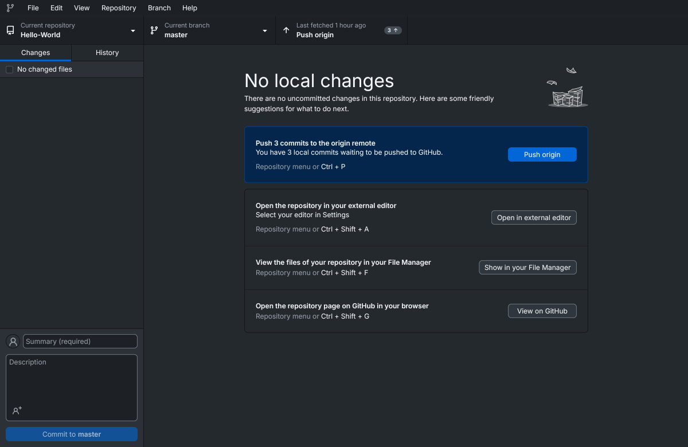

# Tributary

**GitHub Desktop, rewritten from scratch in C++.** No Electron, no Qt, no libgit2, and no shelling out to `git`. The git engine, git's smart-HTTP protocol, the HTTP client, the Vulkan renderer, the TrueType rasterizer and the UI toolkit are all hand-written C++20 (about 16k lines). The release binary is about 3 MB, fonts included.



| Changes (light) | No local changes (dark) |
|---|---|
|  |  |

## Looks like GitHub Desktop

The UI copies GitHub Desktop's design one-to-one. The colors come from Desktop's own stylesheets (`app/styles/_variables.scss` and `themes/_dark.scss`, MIT), compiled with Sass so every value is exact, in light and dark. Sizes and spacing come from the same files: a 50px toolbar with 230px branch and push/pull buttons, a 29px tab bar, 29px file rows, 50px commit rows, 25px buttons and text fields, a 12px base font and 10px spacing. Dialogs, foldouts, the diff gutter, the commit box and the empty states follow Desktop's layout, using Desktop's illustrations.

Windows and Linux get Desktop's File / Edit / View / Repository / Branch / Help menu strip. macOS gets the same menus in the native menu bar, plus Desktop's dark title strip behind the traffic lights. Avatars load from GitHub by commit email, with Desktop's gray placeholder as the fallback.

## Features

These follow GitHub Desktop's workflow.

- **Repositories:** clone from your GitHub account or any HTTPS URL (or `owner/repo`), create a repository (with README, .gitignore and MIT license), add an existing one, or drag a folder onto the window. Repositories are grouped by owner.
- **Changes:** a file list with checkboxes, live diffs, and **partial commits**: click or drag across the gutter to include individual lines, or click a hunk header to toggle the whole hunk. Also: summary and description, amend, undo last commit, discard (whole file or selected lines), ignore a file or extension, and rename detection.
- **History:** lazily-loaded commit list, commit details, changed files and diffs. Revert, create a branch or tag from a commit, check out a commit, copy SHA, view on GitHub.
- **Branches:** create, switch, rename, delete (locally and on the remote), merge into the current branch, and check out remote branches as tracking branches.
- **Sync:** Fetch, Pull (fast-forward or merge), Push with ahead/behind badges, Publish branch, Force push, and a background fetch every 15 minutes.
- **Merge conflicts:** banner and dialog, resolve with ours or theirs, open in editor, continue or abort.
- **Stash:** stash everything (untracked files included), view the stash, restore or discard. The format is compatible with `git stash`.
- **GitHub:** sign in with a token, or OAuth device flow if you add a client ID. Lists your repos, publishes a repository (personal or org, private or public), and shows the branch dropdown's Pull requests tab with PR checkout (`refs/pull/N/head`). Opens Create pull request and View on GitHub.
- **Integrations:** open in editor or terminal, reveal in Finder or Explorer, configurable commands.
- **Settings:** git name and email, default branch, light/dark/system theme, clone folder, confirmations.
- Keyboard shortcuts match GitHub Desktop (⌘1/⌘2, ⌘B, ⌘⇧N, ⌘P, ⌘⇧P, ⌘⇧A, ⌘⇧F, ⌘⇧G, ⌘↩ …).

## Editing on GitHub (no clone)

**File → Edit a repository on GitHub…** (Ctrl/⌘+Alt+E), **Repository → Edit on GitHub in Tributary**, or the welcome screen opens any repository you can read straight from the GitHub API. Nothing is cloned.

- A file tree with "Go to file" fuzzy search, tabs, and a code editor. The editor has line numbers, syntax highlighting (C-family, Go, Rust, Python, shell, Ruby, JSON, YAML, TOML, HTML/XML, CSS, Markdown, SQL, Lua), undo and redo, auto-indent, Tab/Shift+Tab, toggle comment (Ctrl/⌘+/), move line (Alt+↑/↓), and word and line navigation. Images open as previews.
- Create, rename and delete files. Everything you change, across any number of files, shows up in the **Changes** tab with a diff.
- **Create pull request** turns all of it into **one commit on a new branch and one pull request**. If you can't push to the repository, Tributary forks it for you and opens the PR from your fork.
- If someone changed one of your files on the base branch in the meantime, Tributary three-way merges their change into yours. If the two really conflict, the conflict markers open in the editor so you can fix them and submit again.

`tests/github_mock.py` is an in-memory mock of the GitHub endpoints the editor uses, for trying it without a network.

## Architecture

```
src/git/       git engine — SHA-1, zlib inflate/deflate, loose objects, packfiles
               (v2 idx, ofs/ref deltas), pack indexing & building, refs + packed-refs,
               reflogs, config, index v2–v4, .gitignore (wildmatch), Myers diff,
               3-way merge, status, commit, checkout, merge, stash, revert, cherry-pick
src/git/transport.cpp   smart HTTP v0/v1: ref discovery, upload-pack, receive-pack,
               side-band-64k, have/want negotiation, clone / fetch / push / pull
src/net/       HTTP/1.1 client (chunked, redirects, HTTPS_PROXY CONNECT), JSON,
               GitHub REST API; TLS via the OS: Schannel / SecureTransport / OpenSSL
src/gfx/       Vulkan renderer (instanced SDF quads, glyph atlas, scissor batches),
               TrueType parser + coverage rasterizer + GPOS kerning, SVG path rasterizer
src/ui/        immediate-mode UI toolkit: text editing, scroll views, popups, modals
src/platform/  Win32, Cocoa (pure C++ through the Objective-C runtime), X11
src/app/       the GitHub Desktop UI
```

All git work runs on a worker thread, and the UI renders from snapshots. Vulkan is loaded at runtime: `vulkan-1.dll` on Windows, `libvulkan.so.1` on Linux, and the bundled `libMoltenVK.dylib` on macOS. Only Vulkan headers are needed to build.

The engine is tested against real git: `tests/engine_test.sh` (40 checks) and `tests/transport_test.sh` (10 checks against `git http-backend`) verify that git sees exactly the commits, trees, index, stashes and packs Tributary writes, and vice versa (`git fsck --strict` stays clean).

## Building

```bash
# macOS
brew install cmake ninja molten-vk vulkan-headers
./build.sh && open build/Tributary.app

# Linux
sudo apt install cmake ninja-build g++ libx11-dev libssl-dev libvulkan-dev
./build.sh && ./build/Tributary

# Windows (Visual Studio 2022)
build.bat
```

GitHub Actions (`.github/workflows/build.yml`) builds Linux, Windows and macOS (arm64 and x86_64 DMGs) on every push and runs the test suites. Pushing a `v*` tag publishes a release.

## Signing in

**Token:** Sign in opens GitHub's token page with the right scopes (`repo, workflow, read:org, user`). Paste the token in. Tokens are stored in the macOS Keychain, the Windows Credential Manager, or a `0600` file on Linux.

**Browser:** register an OAuth app with Device Flow enabled and paste its client ID into Settings → Advanced. You then get a "Continue with browser" button.

## Also supported

- **SSH remotes** (`git@github.com:owner/repo.git`, `ssh://…`), using your system `ssh` and `GIT_SSH_COMMAND`
- **Image diffs**: 2-up, swipe, onion skin and difference views for PNG, JPEG and GIF
- **Git hooks**: pre-commit, prepare-commit-msg, commit-msg, post-commit and pre-push (`core.hooksPath` respected)
- **Rebase**, interactive history editing (reword, squash, reorder, drop), cherry-pick and squash-merge
- **Git LFS**: files matching `filter=lfs` in `.gitattributes` are stored as pointers. Objects are downloaded on clone, pull and checkout and uploaded on push through the LFS batch API (HTTPS, or SSH via `git-lfs-authenticate`). This works with, and is tested against, the real `git-lfs`.
- **Commit signing**: `commit.gpgsign` with GPG, SSH (`ssh-keygen -Y sign`) or X.509 (`gpgsm`). Rewritten commits are re-signed. Verified with `git verify-commit`.

## Not supported yet

- Submodule updates
- Shallow clones
- `.gitattributes` filters other than Git LFS (`core.autocrlf` is supported)

## License

MIT. See [LICENSE](LICENSE). Inter and JetBrains Mono are under the SIL OFL. Octicons, and GitHub Desktop's theme values and empty-state illustrations (in `assets/illustrations`), are MIT © GitHub; see `assets/illustrations/LICENSE-github-desktop.txt`. GitHub's logos and trademarks are not used. Tributary is not affiliated with GitHub.
